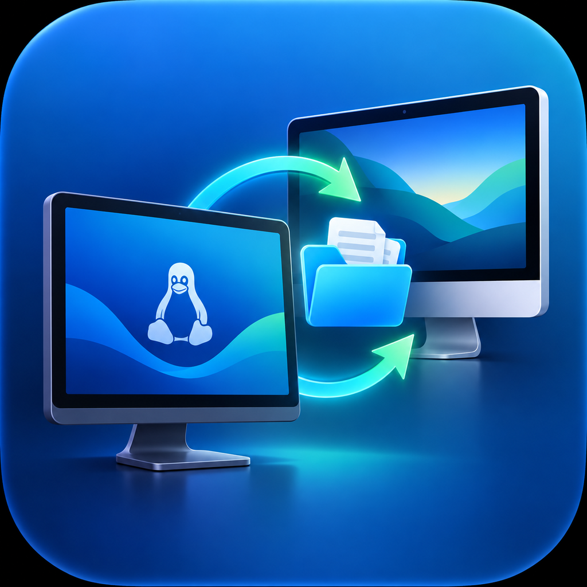
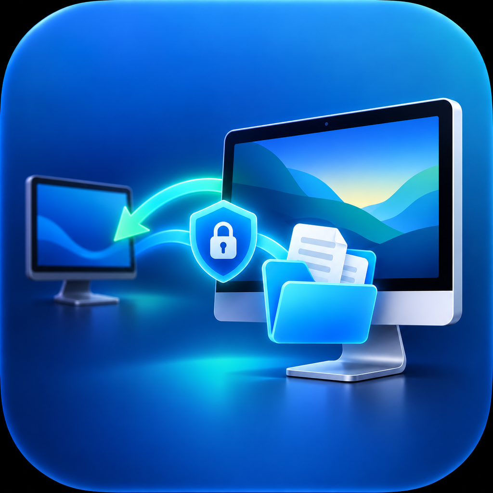

## 0.15.21 LoginWindow first-frame recovery

On macOS 26+ LoginWindow video now starts with continuous ScreenCaptureKit `SCStream`. If SCStream starts but does not submit an initial frame for encoding within two seconds, ZorinMacBridge switches to the `SCScreenshotManager` one-shot fallback. The Zorin client logs which backend is active and continues to report the Stage D first-frame pipeline (`capture-frame` → `pixel-buffer` → `encode-submit` → `h264-written` → decoded frame). CGDisplayStream remains unsupported and is not used.

## 0.15.20 Aqua readiness / pre-login verification split

0.15.20 separates normal host readiness from reboot-to-LoginWindow verification. A logged-in Aqua host can report **READY** when Desktop, Files, System, Terminal and Projects prerequisites are satisfied even if the optional LoginWindow capability probe has not been run for the current build. Pre-login is reported separately as **VERIFIED**, **UNVERIFIED** or **NOT READY**. One capability proof belongs to the Mac/app build and applies to all paired Zorin clients; it is not repeated per client.

## 0.15.18 macOS 26 native build fix

0.15.18 fixes the macOS 26/Xcode 26.6 native CI blockers found after 0.15.17: a Swift 6.3 exclusive-access violation in the capability probe and a stale CGDisplayStream regression test that must not remain tracked. The supported platform remains Apple Silicon (M1+) on macOS 26.0 or later. GitHub Actions remains responsible for building the installable Linux `.deb` and macOS `.dmg`.

## 0.15.17 Apple Silicon / macOS 26+ target

The supported Mac platform is deliberately narrow: **Apple Silicon arm64 (M1 or newer) running macOS 26.0 Tahoe or later**. Intel Macs and macOS 25 or older are unsupported. Native C/Swift artifacts are compiled with deployment target 26.0 and the release app declares `LSMinimumSystemVersion=26.0`. Native CI and tagged macOS packaging run on the Apple-Silicon `macos-26` runner.

LoginWindow capture uses `SCScreenshotManager.captureSampleBuffer()` and the existing VideoToolbox H.264 pipeline. Aqua capture remains on continuous `SCStream`. Stage-B capability probing requires CoreHID on this target and still compares it with the legacy IOHID/Quartz path for diagnostics.

## 0.15.16 Apple Silicon / macOS 15+ target

The supported Mac platform is now deliberately narrow: **Apple Silicon arm64 (M1 or newer) running macOS 15.0 Sequoia or later**. Intel Macs and macOS 14 or older are unsupported. Native C/Swift artifacts are compiled with deployment target 15.0 and the release app declares `LSMinimumSystemVersion=15.0`. CI compiles on the M1 `macos-15` runner as the oldest supported environment and also on `macos-26` for current-SDK compatibility; Xcode 27 is not a required product target.

LoginWindow capture uses `SCScreenshotManager.captureSampleBuffer()` and the existing VideoToolbox H.264 pipeline. Aqua capture remains on continuous `SCStream`. Stage-B CoreHID probing no longer raises the application minimum OS: on the macOS 15 SDK the probe uses ScreenCaptureKit plus the legacy IOHID/Quartz input path; newer SDKs may compile CoreHID only as an optional runtime-gated diagnostic.

## 0.15.8 CGDisplayStream Swift/Xcode fix

0.15.8 targets the real post-reboot LoginWindow failure chain. The server no longer keeps global video ownership during slow native cleanup after capture has already been stopped; this removes the repeated `previous video session did not stop within 4s` reconnect loop seen on real hardware.

For LoginWindow video, the primary capture backend is now `CGDisplayStreamCreateWithDispatchQueue` on the physical display. Frames arrive as IOSurfaces, are wrapped as `CVPixelBuffer`s, and go through the existing VideoToolbox H.264 encoder. `SCScreenshotManager.captureSampleBuffer()` remains a fallback when the display stream cannot be started. The normal logged-in Aqua desktop continues to use `SCStream`.

The first H.264 access unit is still required within six seconds. If neither pre-login capture backend produces a frame, the server returns native diagnostics instead of leaving the client indefinitely on `Waiting for first frame`.

The LoginWindow input path remains IOHIDSystem-first. macOS can still deny synthetic keyboard/click events at SecureEventInput on some builds even when video works; 0.15.8 does not claim to bypass that OS security boundary. Accessibility remains REQUIRED and rejected input is logged per event without tearing down the control session.

# ZorinMacBridge

## 0.15.5 pre-login capture + activation fix

0.15.5 combines the 0.15.4 LoginWindow screenshot-capture path with the missing pre-login update activation step. After `update-now` at LoginWindow, the old pre-login PID must exit and a new process from the updated `/Applications` bundle must reopen the Desktop port before the update can report success. The screenshot-capture fix from 0.15.4 remains unchanged. After a successful Mac update, the System page also triggers a fresh Bonjour scan so the UI reflects the newly running version instead of retaining a stale pre-update label.

For the macOS LoginWindow session on supported macOS 26+, pre-login video now uses `SCScreenshotManager.captureSampleBuffer()` and feeds those samples into the existing VideoToolbox H.264 encoder. The normal logged-in Aqua desktop keeps the existing continuous `SCStream` path. LoginWindow also performs the same Screen Recording preflight instead of silently entering a zero-frame capture when TCC is unavailable.

The 0.15.2 input hardening remains: remote input waits for the first decoded pre-login frame, individual rejected input events do not kill the Desktop session, and the IOHID-to-Quartz fallback is retained.

**0.15.3 is withdrawn and should not be released.** It was based on the incorrect conclusion that 0.15.2 had not become active after the update.

## 0.15.0 pre-login connect fix

When Bonjour/P0 reports **system online** but the normal Aqua Desktop is absent, the client now treats the Mac as awake and recovers the LoginWindow endpoint through the paired P0 channel. It no longer sends Wake-on-LAN merely because the Desktop role is missing. The macOS helper also removes the invalid `gui/0` assumption and can load the pre-login LaunchAgent into an already-existing LoginWindow session after an in-place update.


## v0.14.18 reboot/login-window recovery + stable video reconfiguration

After a normal macOS reboot, ZorinMacBridge now installs a dedicated `LoginWindow` LaunchAgent that starts the same authenticated ZMB Desktop endpoint before the target user has an Aqua session. It reuses the existing TLS identity and password verifier, shows the physical macOS login window, and uses a native IOHIDSystem path for pre-login keyboard/mouse. After successful login, launchd tears down the LoginWindow context and the normal Aqua ZMB server takes over; the Linux client reconnects and restores the selected desktop mode. Files and 2K/4K virtual-display mode remain disabled while still at loginwindow.

0.14.18 also hardens FPS/Quality/Resolution changes: rapid UI changes are coalesced into one video restart, the old native streamer is cleaned up before a replacement owns ScreenCaptureKit, and the Mac notices a closed replacement socket immediately instead of leaving the old capture alive until its pipe timeout.

**Important real-device boundary:** the LoginWindow LaunchAgent and native IOHID code are compiled/tested by the macOS release workflow, but actual login-window capture and password typing must still be accepted on the target M1/macOS build. FileVault preboot is not a macOS loginwindow session and is not covered.
## v0.14.17 fullscreen during video retry

A transient H.264/ScreenCaptureKit failure no longer disables the **Full Screen** control while the authenticated Desktop/control session remains connected. The client reports `Connected — video retrying: ...`, keeps keyboard/mouse available, and retries video independently.


## v0.14.10 repository layout cleanup

0.14.10 is a source-layout cleanup only; runtime behavior is unchanged from 0.14.9. Regression tests now live in `tests/`, acceptance checklists in `docs/acceptance/`, developer notes in `docs/development/`, and CI/release use the single `scripts/run-tests.sh` entry point.

## v0.14.9 default input + explicit fullscreen controls

0.14.9 enables keyboard and mouse forwarding by default as soon as the Desktop session connects. The remote image no longer uses double-click as a local full-screen gesture: every click, including double-click, is forwarded to the Mac. Full-screen is entered only with the explicit **Full Screen** button and exited with **Exit Full Screen**, **Esc**, or **Alt+Esc**. The existing **Capture keyboard & mouse** switch remains available as an explicit view-only override.

## v0.14.8 keyboard reconnect + fullscreen escape regression fix

0.14.8 fixes the keyboard regression introduced in 0.14.6 where ordinary input could tear down the control channel on real macOS. Printable ASCII is sent through the established physical KEY path, Unicode TEXT is fallback-only, and one input-injection error no longer disconnects the session. It also fixes fullscreen recovery: reconnect no longer clears the fullscreen state, **Exit Full Screen** is idempotent, and both **Esc** and **Alt+Esc** are captured locally before remote input forwarding.

## v0.14.7 updater / shutdown reliability

Transient GitHub/CDN gateway responses no longer abort an update on the first failure: update assets retry up to four times with bounded backoff and partial files are discarded before retry. Closing the GTK client is also non-blocking: the window quits immediately while tray/process cleanup is signalled outside the GTK main thread. Update/discovery workers cannot close the application. Persistent lifecycle/crash diagnostics are written to `~/.local/state/zorinmacbridge/client.log` so an unexpected window/process exit leaves evidence outside the GUI.


<p align="center">
  
  &nbsp;&nbsp;&nbsp;&nbsp;
  
</p>

A LAN-first remote desktop bridge for a **Zorin OS / Linux workstation → macOS development machine** workflow.

The intended setup is simple: keep Linux as the main machine for web/app development, and use the Mac only for Xcode, iOS Simulator, signing, builds, or other Apple-only tooling.

The remote session does **not** require a vendor cloud, relay, account, telemetry service, or Internet connection. Optional LAN discovery uses local mDNS/Bonjour only. GitHub is contacted for installation/update checks; P0 can optionally check every 6 hours and, if you choose **Install automatically**, install verified Mac releases without requiring a local monitor.

> **Status:** experimental. This project is still under active development and has not received an independent security audit.

## Native Zorin/GNOME client UI

v0.5 moves the Linux client to **GTK4 + libadwaita**. On Zorin OS / Ubuntu, controls, spacing, dialogs, switches and file browsing now use the desktop's native GTK/libadwaita theme instead of the old raw Tkinter interface.

The `.deb` declares the required Ubuntu/Zorin runtime packages, so the one-command installer still handles everything through `apt`. The client uses system symbolic icons and native file dialogs.


## Repository layout

```text
.
├── assets/                 application artwork
├── docs/
│   ├── acceptance/         real-device/release acceptance checklists
│   └── development/        developer notes
├── native/                 macOS native helper/streamer sources
├── packaging/              Linux desktop/package metadata
├── scripts/                build, signing, verification and test runners
├── tests/                  regression and source-invariant tests
├── *.py                    runtime Python modules
├── install-linux.sh        Linux installer entry point
├── install-macos.sh        macOS installer entry point
└── VERSION                 release version
```

Run the complete regression suite with:

```bash
scripts/run-tests.sh
```

## Install

### Zorin OS / Ubuntu — Client

Copy and paste one command:

```bash
curl -fsSL https://raw.githubusercontent.com/ILoveMyProjects/ZorinMacBridge/master/install-linux.sh | bash
```

The installer downloads the latest `.deb`, verifies its published SHA-256 checksum, installs it with `apt`, and adds **ZorinMacBridge Client** to the application menu.

### macOS — Server

> **Apple Silicon only (arm64). Intel Macs are intentionally unsupported.**
>
> The Apple computer runs **macOS**. iOS is the target platform you build for in Xcode.

Copy and paste one command on the Mac:

```bash
curl -fsSL https://raw.githubusercontent.com/ILoveMyProjects/ZorinMacBridge/master/install-macos.sh | bash
```

The macOS server supports **Apple Silicon (arm64) only**. The installer verifies the Mac architecture, downloads the arm64 `.dmg`, verifies SHA-256, and installs **ZorinMacBridge Server** into `/Applications`. Intel Macs are not supported.

Starting with **0.15.19**, the default macOS release path is certificate-free: GitHub Actions uses ad-hoc transport signing, and installation/update applies one stable per-Mac local ad-hoc designated requirement. Developer ID/provisioning remains optional when a maintainer explicitly configures it; it is not required for CI, DMG creation, installation, updates, or READY.

## Remote desktop architecture

The old prototype captured individual JPEG screenshots and sent them on the same connection used for mouse and keyboard input. That design could eventually fill the TLS socket buffer and block/disconnect the whole remote session.

v0.4 changes the architecture:

```text
Linux client                         macOS server

control TLS socket   ──────────────► mouse / keyboard / clipboard
video TLS socket     ◄────────────── H.264 stream
file TLS sockets     ◄─────────────► files / folders
```

Starting with **0.15.12 Stage D**, LoginWindow is treated as one explicit remote session rather than three unrelated authenticated sockets. Desktop authentication owns the pre-login input session and returns an in-memory `session_token`; the video connection must present that token and cannot outlive a replaced Desktop owner. The server reports native pipeline progress (`capture-frame -> pixel-buffer -> encode-submit -> h264-written`), while the Linux client confirms the final `client-decoded` step with `First H.264 frame decoded`. When macOS changes `/dev/console` from LoginWindow to the logged-in user, the server announces an explicit Aqua handoff, releases the pre-login listener, and the client performs a fast reconnect to the normal user-session server.

The video path uses:

- **ScreenCaptureKit** for continuous macOS display capture **inside the main server process**;
- **VideoToolbox** for real-time H.264 encoding on the Mac;
- **PyAV/FFmpeg** for H.264 decoding on Linux;
- a dedicated TLS video connection so slow video rendering cannot block mouse/keyboard traffic.

A completely static macOS desktop can legitimately produce no new ScreenCaptureKit/H.264 data for a while. The Linux client therefore treats video socket read timeouts as idle intervals rather than disconnects. TCP keepalive and the control channel are used to detect real peer loss.

The Linux client exposes **three independent video controls** at the top of Desktop:

- **Resolution:** `1080p`, `2K`, `4K`
- **FPS:** `24`, `30`, `60`
- **Quality / bitrate:** `Adaptive`, `Low`, `Balanced`, `High`, `Ultra`

Quality does **not** change resolution or frame rate. The fixed bitrate presets are Low = 3 Mbit/s, Balanced = 8 Mbit/s, High = 20 Mbit/s, Ultra = 40 Mbit/s. Adaptive changes bitrate only (roughly 3–12 Mbit/s); it never silently changes the chosen FPS or resolution.

**1080p** is the safe/default physical MacBook display path (ScreenCaptureKit captures the physical display without upscaling it). **2K** and **4K** create real virtual macOS desktops at exactly 2560×1440 and 3840×2160. The server clamps all client requests to sane limits before starting VideoToolbox.

## Normal setup

### First setup on the Mac

1. Install **ZorinMacBridge Server**.
2. Open it locally once.
3. In the macOS server window, use **Request Screen Recording Access** if the status says *Not granted*, then approve **ZorinMacBridge Server** in macOS. v0.4.3+ keeps capture inside that same app process.
4. Use **Request Mouse/Keyboard Access** if input control is not granted. The app requests permission for synthetic Core Graphics events and opens the relevant macOS privacy pane when needed.
5. Enter a session password of at least 12 characters.
6. Keep **Remember password verifier on this Mac** enabled.
7. Click **Start server**.
8. If you want unattended recovery, use **Enable / Repair** in the **Unattended access / recovery** section and keep the shown SSH fingerprint for the first Zorin pairing.

The Mac stores only a salted PBKDF2 password verifier; it does not store the plaintext session password.

### First connection from Zorin/Linux

1. Open **ZorinMacBridge Client**.
2. Select the discovered Mac.
3. Verify/paste the Mac TLS SHA-256 fingerprint once.
4. Enter the session password.
5. Keep **Remember this Mac** enabled.
6. Connect.
7. For unattended recovery, open **System → Pair / Configure**, verify the Mac SSH fingerprint, and complete the one-time device pairing.

After a successful connection, the client stores:

- the trusted TLS fingerprint in its local config;
- the session password in the Linux desktop system keyring when available;
- the Mac's persistent random server ID, so credentials are associated with the machine rather than only its current IP address.

On later connections, discovery can restore the saved fingerprint/password automatically.

## Passwords: do not mix these up

ZorinMacBridge uses two different credentials:

- **ZorinMacBridge session password** — an app-specific password for the normal Desktop connection. Create it on the Mac during command-line installation or in the Server window. It should be different from your macOS login password. The Mac stores only a salted PBKDF2 verifier.
- **macOS account password** — the normal password you use to log in/unlock the Mac. It is used only once by **System → Pair / Configure** to authenticate the first SSH connection and install the restricted Ed25519 device key. The Zorin client does not save this password.

`install-macos.sh` now performs unattended setup by default: it enables Remote Login (SSH), installs/repairs P0, verifies that SSH was enabled, and prompts for the ZorinMacBridge session password. Use `./install-macos.sh --app-only` only when you intentionally want to install the app without P0/SSH setup.


### Desktop trust is part of System pairing (v0.14.4)

On the Zorin GTK client, Desktop no longer has a second user-managed SHA trust workflow. Pair the Mac once in **System**. The client persists the Desktop TLS fingerprint learned through that verified SSH channel and uses it automatically for Desktop connections. The Desktop trust field is read-only diagnostics.

For Macs still running an older P0 helper, the Zorin client can recover the existing Desktop certificate fingerprint through the already-pinned SSH profile, so migration does not require walking back to the Mac to copy another SHA. Once a Desktop TLS identity is pinned, a different certificate is treated as an identity change and is blocked rather than silently replacing saved trust.

### Remembered SSH identity and migration hotfix (v0.14.3)

After the first verified System pairing, ZorinMacBridge reuses the pinned SSH host key from its private `known_hosts` file. Reconfiguration automatically compares the live Mac key with the remembered key; normal reboot, logout, DHCP changes and updates do **not** require another trip to the Mac. A genuinely changed SSH host key is treated as a security event and requires explicit re-verification.

When pairing against an older P0 helper that does not yet report the Desktop TLS fingerprint, the client learns that fingerprint during the same password-authenticated, host-key-pinned SSH session. This preserves the one-pairing UX during upgrades from older releases.

The macOS root updater also canonicalizes its `/var/tmp` staging directory before containment checks, avoiding the macOS `/var` → `/private/var` alias false-positive.

### One pairing, shared trust (v0.14.2)

A successful **System → Pair this Mac** now becomes the single trust ceremony for the selected Mac. The user still verifies the macOS SSH host fingerprint once. After that verification, P0 returns the desktop TLS SHA-256 fingerprint through the already-pinned SSH channel, and the Zorin client stores it as the Desktop certificate pin automatically. Bonjour/mDNS is **not** used as a source of trust. Terminal / Project Actions, Xcode and Files refresh their state immediately after pairing, so they no longer remain stuck on stale "not paired" UI until the machine is reselected. Files still requires an active authenticated Desktop session because file transfer is carried on that channel.

Starting with **v0.14.0**, the Mac app treats normal Aqua prerequisites as an explicit setup contract rather than optional-looking status. The **Required setup for normal Aqua operation** panel turns red and lists missing items such as Screen Recording, Accessibility, the saved ZMB session password, P0/recovery services, Remote Login/SSH readiness and host fingerprint, launch-at-login, and automatic desktop-server start. **0.15.20 corrects Stage F:** the LoginWindow LaunchAgent and capability proof no longer block normal READY. Reboot-to-LoginWindow readiness is shown separately as VERIFIED / UNVERIFIED / NOT READY. The proof is still bound to app version + CDHash, but it is Mac/build-scoped rather than client-scoped, so one successful probe from any paired Zorin client applies to all paired clients for that build.

## LAN discovery and changing DHCP addresses

The Zorin client discovers both the normal desktop service and the P0 system service with Bonjour/mDNS. Each Mac has a persistent `server_id` UUID. The current IP address is treated only as a transport address and may change after DHCP renewals or reboots.

When P0 is enabled, the system LaunchDaemon advertises `_zorinmacbridge-admin._tcp` independently of the user-session desktop app. This lets **Find Macs** rediscover the same Mac by `server_id`, hostname, and its current IP even if the desktop streamer has crashed. Saved TLS and SSH host-key pinning still verify the machine before trusted connections are accepted.

The project deliberately does not use a network-interface MAC address as the persistent identity. A Mac can have multiple interfaces and modern macOS can use private Wi-Fi addresses; the application-level UUID plus pinned cryptographic identities are more appropriate.

## Unattended access / recovery (P0)

The remote desktop still runs in the logged-in macOS user session because ScreenCaptureKit and GUI input belong to that session. The P0 system layer remains technically separable from the desktop server, but v0.14.0 marks it **REQUIRED for the intended full unattended Zorin workflow** so a failed desktop service does not force you to reconnect a monitor.

On the Mac, open **ZorinMacBridge Server → Unattended access / recovery → Enable / Repair** once. macOS asks for administrator authorization. The app then:

- keeps the existing user LaunchAgent for the actual desktop streamer;
- installs a small root LaunchDaemon for heartbeat/recovery only;
- enables macOS Remote Login (SSH) as the administration transport;
- opens **no custom privileged network port**;
- shows the Mac SSH host fingerprint for first pairing.

On Zorin, select the same Mac in the normal selector and open **System → Pair / Configure**. Verify the displayed SSH fingerprint against the Mac, then enter the macOS short username/password once. The password is used only for that first SSH login and is not saved. The generated Ed25519 key is restricted with a forced command, so it cannot be used as a general shell key or for SSH tunnelling.

After pairing, the **System** page provides health/status, ZMB start/stop/restart, startup repair, logs, sleep, reboot and shutdown. A paired Mac remains in the same normal selector as **paired/offline** when its desktop mDNS advertisement disappears, so the System page can still be used to recover the desktop service.

The system layer does not bypass macOS login, FileVault, Screen Recording, or Accessibility. If there is no logged-in GUI session, system administration can remain available but there is no normal desktop to stream. Reboot is blocked by the helper when FileVault state indicates that local unlock may be required.

### Remote Login and Full Disk Access on current macOS

macOS may refuse `systemsetup -setremotelogin on` unless the invoking process has Full Disk Access. The P0 files can still be installed safely, but v0.14.0 no longer presents that state as effectively finished: command-line setup reports `SETUP_COMPLETE=0`, and the Mac UI shows **REQUIRED: Remote Login (SSH)** in red until **System Settings → General → Sharing → Remote Login** is turned on. Pairing, System, Terminal, and Project actions are not considered ready while this requirement is missing. Rerunning P0 is not required after enabling the switch; **Enable / Repair** can also repair missing SSH host keys.


## Xcode and Simulator control (v0.9.0)

After P0 pairing, the Zorin client includes an **Xcode** tab. It reads the active Xcode developer directory and Xcode version, lists available Simulator devices, can boot/shut down a selected Simulator, and can open Xcode or Simulator in the logged-in macOS GUI session. These commands use Apple's `xcodebuild`/`xcrun simctl` toolchain and the same restricted SSH administration key; the key still cannot execute an arbitrary shell command.

The **System** tab also exposes a P1 machine state (`DESKTOP READY`, `SYSTEM ONLINE`, `RECOVERY NEEDED`, or `DEGRADED`), power/battery information, **Recover desktop**, and the macOS Wake-for-network-access setting. The client can use the paired Mac network address for Wake-on-Connect; whether a sleeping MacBook actually wakes still depends on its hardware, power state, Wi-Fi/Ethernet path, and network.

For real-Mac validation before tagging the release, follow [`docs/acceptance/P1_P2_ACCEPTANCE.md`](docs/acceptance/P1_P2_ACCEPTANCE.md).


## Terminal and Project Actions (v0.10.0)

P3 adds two normal pages to the Zorin client: **Terminal** and **Projects**. They use a separate pinned Ed25519 key for the paired macOS user; they do not reuse or weaken the restricted P0 admin key. Re-open **System → Pair / Configure** once after upgrading and keep **Enable Terminal / Project Actions** checked to install that user-level key. The macOS account password is used only for that one pairing login and is not saved.

The **Terminal** page uses GTK4 VTE for a real PTY-backed SSH session. The **Projects** page stores local per-Mac project metadata and can stream/cancel Git/Xcode actions: Git status, fast-forward-only pull, Xcode inspection/open, build, test, and clean. Long actions run outside the GTK thread so the client remains responsive. Project profiles contain no credentials.

Because projects are bound to the persistent `server_id`, a DHCP address change only updates the transport address; it does not create a new project identity.

See [`docs/acceptance/P3_ACCEPTANCE.md`](docs/acceptance/P3_ACCEPTANCE.md) before publishing the first 0.10.0 release.

## Project Sync (v0.11.0)

P4 extends each saved **Projects** profile with an absolute **Local Zorin project directory**, the existing remote macOS project directory, and optional extra exclude patterns. **Preview sync** performs dry-run comparisons in both directions and classifies changes as outgoing, protected Mac-side changes, or remote-only files. **Sync Zorin → Mac** is deliberately one-way: it never uses `--delete`, uses rsync `--update`, and exact-excludes every path identified as a protected conflict before the real transfer starts.

The default excludes are `.git/`, `DerivedData/`, `.build/`, `build/`, `xcuserdata/`, `*.xcuserstate`, and `.DS_Store`. Project-specific excludes such as `node_modules/` can be added to the saved profile. Project Sync reuses the pinned P3 normal-user SSH transport and therefore receives no P0/root privileges. The GTK UI remains responsive and a running transfer can be cancelled.

The first P4 release intentionally does **not** implement blind bidirectional sync or remote deletion. A newer/different Mac-side file is treated as something to protect, not something to overwrite automatically.

See [`docs/acceptance/P4_ACCEPTANCE.md`](docs/acceptance/P4_ACCEPTANCE.md) before publishing the first 0.11.0 release.

## Remote desktop performance (v0.12.0)

P5 adds an **Adaptive** video mode intended for running Xcode and Simulator on the Mac without wasting CPU/GPU/network bandwidth on pixels the Zorin window cannot present. Adaptive starts from the current desktop viewport, monitors client latest-frame drops in five-second windows, drops to a cheaper tier quickly when the client falls behind, and only raises quality after sustained stability. Manual Low/Balanced/High/Ultra profiles remain available.

Changing video quality no longer tears down the authenticated desktop/control session. Only the dedicated H.264 connection is replaced, so keyboard/mouse state, file browsing, Terminal, Projects, and P0 remain independent. The GTK client shows the effective profile, stream FPS, receive Mbit/s, local dropped-frame percentage, and render-queue delay.

Both ends are deliberately latency-biased: the Linux frame queue stores only the newest frame; GTK avoids texture work while unmapped; the native ScreenCaptureKit queue depth is two; VideoToolbox is configured for real-time one-frame delay; and the Swift pipe writer never accumulates more than one pending encoded access unit. If the consumer slows down, stale video is discarded instead of being delivered late.

See [`docs/acceptance/P5_ACCEPTANCE.md`](docs/acceptance/P5_ACCEPTANCE.md) before publishing the first 0.12.0 release.

## Layered recovery (v0.13.0)

P6 turns recovery into an explicit diagnostic workflow. **System → Run diagnostics** reports which layer failed (P0 daemon/heartbeat, system Bonjour, SSH transport, application/signature/verified backup, desktop LaunchAgent/process/port, updater lock or update scheduler) and marks each issue as automatic or manual. The Zorin client also classifies failures that happen before the Mac helper can answer, including a pinned SSH host-key change, connection refusal, network unreachable and timeout. A changed host key is never accepted automatically.

**Recover all safe layers** is deliberately bounded: it can reload valid launchd jobs, regenerate the user LaunchAgent, clear only a stale updater lock, restore only a verified update backup, and restart/verify the desktop service. It does not alter FileVault or user accounts, does not force-enable SSH, and refuses to launch an unverified application when no verified backup exists. Autoheal records a bounded recovery event log and waits for three consecutive desktop-port failures before restarting a still-running process.

See [`docs/acceptance/P6_ACCEPTANCE.md`](docs/acceptance/P6_ACCEPTANCE.md) before publishing the first 0.13.0 release.

## Stable macOS permissions

macOS controls Screen Recording and mouse/keyboard control through its privacy/TCC system. ZorinMacBridge cannot silently grant itself those permissions. In v0.5.2+, the server window has explicit **Request Screen Recording Access** and **Request Mouse/Keyboard Access** buttons. Those APIs are invoked only by a local click on the Mac; a remote connection never triggers a privacy prompt.

For permissions and restricted capabilities to survive updates, production releases use one Apple-issued code identity from build through installation. The stable bundle identifier is:

```text
com.ilovemyprojects.zorinmacbridge.server
```

The Stage-B probe can report whether optional restricted capabilities such as `com.apple.developer.persistent-content-capture` or `com.apple.developer.hid.virtual.device` are present. They are **not required by the default free release path**. The physical capability probe, not a paid entitlement, decides whether LoginWindow capture/input is actually usable. See [`SIGNING.md`](SIGNING.md).

## Remote controls

- continuous H.264 macOS screen stream;
- explicit **Capture keyboard & mouse** switch in the Linux client;
- mouse movement, left/right/middle click, drag and drop with input capture enabled by default;
- scrolling and keyboard input with input capture enabled by default;
- Linux-friendly shortcut mapping;
- bidirectional text clipboard;
- file and complete-folder transfer;
- client-selectable H.264 quality presets;
- optional automatic reconnect after unexpected LAN/session drops.

The client starts in **view-only mode**. Enable **Capture keyboard & mouse** when you want local input to control the Mac. Turning it off immediately releases any keys/modifiers/buttons the client believes are held down.

### Full-screen remote desktop

- Use the explicit **Full Screen** button to enter full-screen mode.
- While full-screen, a dedicated top toolbar sits outside the remote Mac image and shows connection state, selected video quality, input-capture state, and the exit control. It never overlays the Mac desktop.
- Leave full-screen with **Esc**, **Alt+Esc**, or the **Exit Full Screen** button.
- Double-click is never consumed by the local UI; it is always delivered to the remote Mac.
- **Alt+Esc is reserved locally** while full-screen is active and is not sent to the Mac.
- Entering or leaving full-screen releases held remote input state to avoid a stuck Alt/Ctrl/Command key.

### Video quality and reconnect

Use **Video quality** in the connection card to choose Adaptive, Low, Balanced, High, or Ultra. **Adaptive** is the default and can move between Eco/Efficient/Balanced/Sharp internal tiers according to viewport size and observed client frame drops. A manual quality change is applied by reconnecting only the H.264 channel; the control session stays up.

The connection card also shows live P5 video telemetry. **Auto reconnect** is enabled by default for the control session; if that control session ends unexpectedly, the client retries with bounded backoff. Choosing **Disconnect** manually cancels pending reconnect attempts.

### Keyboard mapping

| Linux keyboard | Remote macOS |
|---|---|
| Left `Ctrl` | `Command (⌘)` |
| Right `Ctrl` | real macOS `Control` |
| `Ctrl+C` | `⌘C` |
| `Ctrl+V` | `⌘V` |
| `Ctrl+A` | `⌘A` |
| `Ctrl+S` | `⌘S` |
| `Ctrl+Z` | `⌘Z` |
| `Ctrl+F` | `⌘F` |

Use **Right Ctrl+C** when you need real macOS `Control+C`, for example to interrupt a process in Terminal.

Starting with v0.14.6, ordinary printable ASCII keys are delivered with their real macOS virtual keycodes (plus the intended Unicode character). This matters for Xcode's iOS Simulator, which can treat keycode-only/Unicode-only synthetic events differently from normal AppKit text fields; typing `b`, `c`, digits, punctuation, and shifted ASCII no longer reuses the physical `A` keycode.

## Clipboard

Text clipboard synchronization is built in:

- `Ctrl+V` pushes the Linux clipboard to macOS before sending `⌘V`;
- after copy/cut, the client can pull the macOS text clipboard back to Linux;
- explicit **Clipboard Linux → Mac** and **Clipboard Mac → Linux** buttons are available.

Clipboard synchronization is currently text-only.

## Shared files and folders

The Linux **Files** page is now a native GTK/libadwaita-style browser with system folder/file icons, the current remote path, upload/download actions, parent navigation, refresh, and native Zorin/GNOME file/folder pickers.

The default macOS share is:

```text
~/ZorinMac-Share
```

From Linux you can:

- browse the remote directory tree;
- create folders;
- upload one or many files;
- upload a complete directory tree;
- download individual files;
- download complete directory trees.

Remote file access is restricted to the configured share root. Symlinks are skipped.

On the Mac server, click **Open Shared Folder** (or press **Command+Shift+O**) to open the configured share directly in Finder. The default is `~/ZorinMac-Share`.

File transfer is explicit rather than automatic two-way source synchronization. This avoids silently overwriting newer project files when both machines have changed the same path.

## LAN auto-discovery

While the server is running, it can advertise:

```text
_zorinmacbridge._tcp.local.
```

The advertisement contains basic LAN connection metadata and a persistent random server ID. It does **not** publish the session password, TLS private key, clipboard contents, or shared files.

Discovery does not automatically create trust. On first pairing, verify the TLS fingerprint shown by the Mac. After that successful pairing, the Linux client can remember the trusted fingerprint locally.

## Updates

The normal desktop updater is still available through **Help → Check for updates**.

With P0 enabled and the Mac paired, the Zorin **System** tab also provides:

- **Check update** — query the official GitHub release from Zorin;
- **Update now** — download, verify and install the Mac update remotely with no local password prompt;
- **Automatic updates: Off / Notify only / Install automatically**.

The scheduled Mac updater runs every 6 hours. `Notify only` records whether a newer release exists and exposes it in the System tab. `Install automatically` downloads the Apple Silicon `.dmg`, verifies SHA-256, bundle/version and code signature, then applies the stable per-Mac local ad-hoc identity for the default free release before installation. If an optional Developer ID release is present, that publisher signature is preserved instead. The updater makes a backup, installs the replacement, refreshes the bundled P0 helpers, and restarts the desktop service when a user GUI session exists. A failed install rolls the application bundle back.

The P0 updater is a separate system LaunchDaemon from the recovery daemon so replacing/reloading recovery components cannot terminate the update transaction that is performing the replacement. No additional privileged network listener is opened; remote control still travels through the restricted SSH key.

On Linux, the regular in-app update path continues to use the verified `.deb` and system package manager.

You can also re-run the one-command installers.


## Xcode and Simulator control (v0.9.0)

After P0 pairing, the Zorin client includes an **Xcode** tab. It reads the active Xcode developer directory and Xcode version, lists available Simulator devices, can boot/shut down a selected Simulator, and can open Xcode or Simulator in the logged-in macOS GUI session. These commands use Apple's `xcodebuild`/`xcrun simctl` toolchain and the same restricted SSH administration key; the key still cannot execute an arbitrary shell command.

The **System** tab also exposes a P1 machine state (`DESKTOP READY`, `SYSTEM ONLINE`, `RECOVERY NEEDED`, or `DEGRADED`), power/battery information, **Recover desktop**, and the macOS Wake-for-network-access setting. The client can use the paired Mac network address for Wake-on-Connect; whether a sleeping MacBook actually wakes still depends on its hardware, power state, Wi-Fi/Ethernet path, and network.

For real-Mac validation before tagging the release, follow [`docs/acceptance/P1_P2_ACCEPTANCE.md`](docs/acceptance/P1_P2_ACCEPTANCE.md).

## Stable macOS permissions across updates

There is no signing setup to run on Zorin/Linux and no paid Apple signing setup is required. The default macOS release uses free ad-hoc transport signing in GitHub Actions and a stable per-Mac local ad-hoc identity at install/update time. Developer ID is an optional enhancement only when a maintainer already has the relevant Apple credentials.

See [`SIGNING.md`](SIGNING.md) for the free/default and optional signing paths.

## Security model

- LAN/private-address connections only;
- TLS 1.2+;
- pinned SHA-256 server certificate fingerprint;
- password authentication after TLS verification;
- separate video/control/file channels;
- no cloud relay;
- no vendor account;
- no telemetry;
- no UPnP/router configuration;
- file access constrained to the configured share directory;
- plaintext server password is not stored on the Mac;
- remembered Linux passwords use the desktop system keyring when available;
- P0 is optional and uses native macOS SSH rather than a new privileged network listener;
- P0 device keys are Ed25519 keys restricted to a fixed command gateway;
- the system helper accepts only a closed administration command set and does not bypass macOS TCC/FileVault.

See [SECURITY.md](SECURITY.md).

## Releases

Manual downloads:

- [Linux amd64 `.deb`](https://github.com/ILoveMyProjects/ZorinMacBridge/releases/latest/download/ZorinMacBridge-Client_linux-amd64.deb)
- [macOS Apple Silicon `.dmg`](https://github.com/ILoveMyProjects/ZorinMacBridge/releases/latest/download/ZorinMacBridge-Server_macOS-arm64.dmg)

---

# Build / run from source

Normal users should use the installers above.

## Linux client

The source client uses the native Zorin/Ubuntu GTK stack. The setup script installs the required system packages, then `run_client.sh` launches the GTK4/libadwaita client.

```bash
git clone https://github.com/ILoveMyProjects/ZorinMacBridge.git
cd ZorinMacBridge
chmod +x scripts/setup-source-linux.sh run_client.sh
./scripts/setup-source-linux.sh
./run_client.sh
```

## macOS server

macOS 26.0+ on Apple Silicon (M1 or newer) and Xcode Command Line Tools are required for the native in-process ScreenCaptureKit/VideoToolbox streaming library. Intel Macs and macOS 25 or older are intentionally unsupported.

```bash
git clone https://github.com/ILoveMyProjects/ZorinMacBridge.git
cd ZorinMacBridge
chmod +x scripts/setup-source-macos.sh scripts/build-macos-streamer.sh
./scripts/setup-source-macos.sh
./.venv/bin/python mac_server_gui.py
```

## Tests

```bash
scripts/run-tests.sh
python -m compileall -q .
swiftc -frontend -parse native/macos/ZMBStreamerLib.swift
```

The final macOS compilation of the native streaming dylib is performed on the macOS GitHub Actions runners because ScreenCaptureKit and VideoToolbox are macOS frameworks. The dylib is loaded into `ZorinMacBridge Server.app` with `ctypes`; it is not launched as a child capture process.

Starting with 0.15.9, native macOS compilation is also a required **push/pull-request CI gate**, not only a release-time build. GitHub Actions compiles the native dylib on the Apple-Silicon `macos-26` runner through `scripts/verify-macos-native-gate.sh`. A tagged release is blocked until the same gate passes, preventing Swift/SDK compile failures from being discovered only after tagging.

### Stage B: prove LoginWindow capabilities before changing runtime again

0.15.10 adds a diagnostic-only capability probe. It runs as the existing `ZorinMacBridge Server.app` identity inside the real `LoginWindow` launchd session and classifies capture and input independently. Capture PASS requires a real non-uniform ScreenCaptureKit image saved as `/var/tmp/zmb-capability-probe.png`; input PASS requires a harmless Shift down/up to be observable in the LoginWindow session. The probe also reports the effective Persistent Content Capture and CoreHID virtual-device entitlements. It does **not** type text, does not know the login password, and does not modify the production video/input paths. See `docs/development/STAGE_B_CAPABILITY_PROBE.md`.

### Stage C history and 0.15.19 free-signing correction

0.15.11 introduced a Developer ID/provisioning gate. **0.15.19 supersedes that as a mandatory release requirement.** The default release now uses free ad-hoc transport signing plus a stable per-Mac local identity. Developer ID/profile validation remains only as an optional branch. See [`SIGNING.md`](SIGNING.md).

## Troubleshooting

The Linux client includes a **Logs** tab. Connection logs show TCP, TLS, fingerprint verification, authentication, control-channel state, H.264 video-channel state, decode errors, and disconnect reasons. Passwords are never written to the logs.

If macOS asks for Screen Recording **when you press Connect**, make sure you are on v0.4.3 or newer. v0.4.0-v0.4.2 launched a separate native capture executable, which could be treated as separate TCC-responsible code. v0.4.3 runs ScreenCaptureKit in the main server process instead.

On 0.15.19+ the normal free installation reports a stable local ad-hoc identity. An optional Developer ID build may instead report its team/profile. Neither mode alone proves LoginWindow support; use the Stage-B capability probe.

If video works but mouse/keyboard does not, check the Mac server log for:

```text
Accessibility permission: granted
```

If it says Accessibility is not granted, enable **ZorinMacBridge Server** under **System Settings → Privacy & Security → Accessibility**, then quit and reopen the application.

## License

MIT — see [LICENSE](LICENSE).

## macOS privacy permissions and updates

Screen Recording and Accessibility are macOS TCC permissions tied to the app's code identity. The default free path uses a stable explicit per-Mac designated requirement across updates; optional Developer ID builds preserve their publisher identity. ZorinMacBridge never bypasses TCC; missing user consent still requires the appropriate local macOS approval.

### macOS privacy permissions across updates

Starting with **0.15.19**, the default free update path reuses one stable per-Mac ad-hoc designated requirement across releases. Optional Developer ID builds preserve their publisher signature instead. See [`SIGNING.md`](SIGNING.md).


### True 2K/4K virtual desktop and sleep resilience (0.14.14)

The MacBook still has only its own built-in panel; your 2K/4K monitors are on **Zorin**. In 0.14.14, selecting **2K** or **4K** no longer enlarges or crops the MacBook panel. ZorinMacBridge creates a real macOS virtual display at exactly **2560×1440** or **3840×2160**, makes that virtual desktop primary for the current login session, and asks ScreenCaptureKit to capture that display ID directly.

The resolution selector is therefore a real remote-desktop mode: **1080p** uses the physical Mac display, while **2K / 4K** create a virtual macOS desktop. In 0.14.17, the built-in MacBook panel is detached from the active workspace while 2K/4K is in use, so windows/menu bar cannot remain stranded on the broken physical panel. The detach is session-scoped and the built-in display is restored before returning to 1080p or when the owning Desktop control session ends.

The virtual-display path uses the private `CGVirtualDisplay` API plus the private `SLS/CGSConfigureDisplayEnabled` symbol, both resolved at runtime. If Apple removes or changes them, ZMB reports the failure; it does not silently fall back to fake upscaling or to the physical panel for an explicit virtual-display request. ScreenCaptureKit waits for the exact virtual display ID before starting capture.

Input follows the active capture display dynamically, so pointer coordinates map to the virtual desktop itself. Resolution, FPS and bitrate are independent controls.

For the sleep problem, ZorinMacBridge Server now holds a runtime idle-sleep assertion while it is running. The built-in display may still turn off and macOS may still show its normal lock/login screen, but ordinary display-off no longer automatically sends the whole Mac into idle system sleep and makes the server unreachable. This does **not** change `pmset`, automatic login, FileVault, password or lock-screen policy. A deliberate/manual Sleep is still allowed; for that case the existing saved-Mac **Connect → Wake-on-Connect** path remains the recovery mechanism.

If ScreenCaptureKit is interrupted anyway, the control/input connection stays alive and only the video channel is retried.

### Desktop state + independent video controls (0.14.17)

The Desktop toolbar now has separate **Resolution**, **FPS**, and **Quality** selectors. Changing Quality never changes FPS or resolution; changing FPS never changes resolution; changing Resolution never changes the chosen FPS/bitrate. A full Desktop reconnect reuses the current resolution selection instead of silently resetting the remote workspace to the physical display.

Connect is control-first: TLS/authentication and input/control come up independently of the H.264 worker. When 2K/4K is selected, the server prepares the headless virtual display before video starts. If that preparation fails, the control session remains connected and video can retry or the user can switch back to 1080p. Video-only errors likewise leave Full Screen/input available while the H.264 channel retries.

Older Ubuntu/Zorin `pystray` builds that still call Pillow's removed `Image.ANTIALIAS` are handled by a local compatibility shim, so a tray-icon failure does not produce the previous Pillow traceback.

### Wake-on-Connect and full-screen controls (0.14.11)

For a saved paired Mac that is sleeping/offline, pressing **Connect** now sends Wake-on-LAN packets and actively probes the paired Mac until its Desktop service returns, then continues the normal connection. This does **not** change macOS login or lock-screen policy: if the Mac wakes to its login/lock screen, you continue to enter the password yourself through the remote Desktop as before.

GTK full-screen state is synchronized with the real GTK4 window state. **Full Screen**, **Exit Full Screen**, **Esc**, and **Alt+Esc** are local controls and do not depend on the network reconnect state.

## 0.14.16 Linux packaging hotfix

Version 0.14.16 fixes the 0.14.15 Linux `.deb` packaging regression where `linux_client_gtk.py` imported `zmb_shutdown.py` but the release workflow did not install that module into `/usr/lib/zorinmacbridge`. The release workflow now stages the module, smoke-imports the GTK client from the exact package tree, and verifies the built `.deb` contains it.

## 0.14.15 shutdown hardening

Explicit **Close/Quit** is bounded: the GTK window is hidden immediately, GTK is allowed to destroy it normally, SSH/VTE/tray cleanup is best-effort and non-blocking, and a short hard-exit watchdog prevents a stuck native backend from leaving the client process alive. This watchdog is armed only for explicit application shutdown; it is not used for ordinary Desktop disconnect/reconnect.
